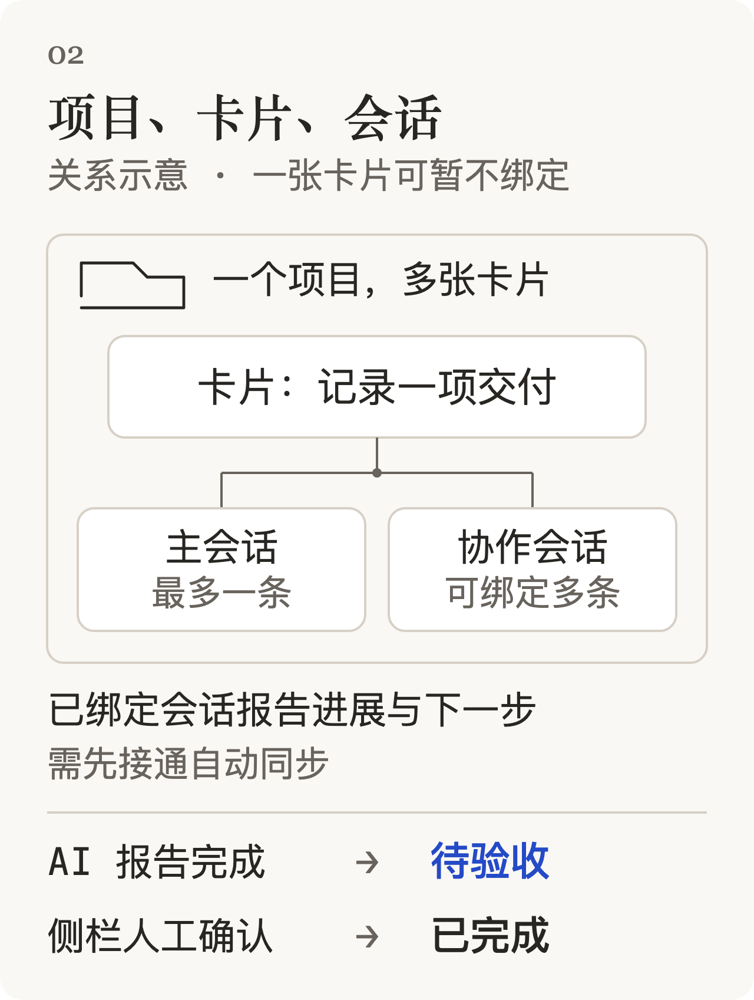
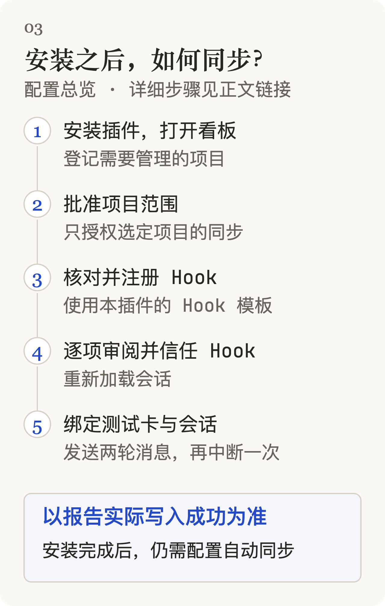

# Codex Kanban

在 Codex 桌面应用侧栏管理项目、任务卡片与 AI 会话进展。

**0.3.3-preview.1 · 开发预览 · MIT**。这是独立的 GitHub 插件源，不是 OpenAI 官方目录中的插件。当前只面向 macOS 测试；Windows、Linux 和其他版本宿主未验证。不要将工程测试通过理解为全部产品需求验收通过。


*卡片字段示意，使用合成示例数据；不是应用截图。*

## 能做什么

- 按项目查看看板或表格；卡片有未开始、计划中、进行中、待验收、已完成、暂停六种状态。
- 记录进展、下一步、跟进人、跟进时间和计划交付日；查看今天需跟进及逾期事项。日期视图目前采用北京时间。
- 将已有 Codex 会话绑定到卡片，或通过宿主工具新建并关联会话；卡片上的“打开会话”直接导航。
- 使用检查、验收、卡点清单、成果链接和活动记录；修改可追溯，最终完成及验收由用户在侧栏确认。
- 在单独启用并信任 Hook 后，让已绑定会话报告进展。安装插件本身不会启用所有项目的自动同步。



*项目与会话关系示意。“打开会话”进入卡片的主会话。*

## 安装开发预览

需要已安装并登录的 Codex 桌面应用、可发现的官方 Codex CLI，以及 Node.js ≥22.12（包含 `node:sqlite`；本次测试版本为 Node 24.20.0）。自动同步还要求宿主支持并信任生命周期 Hook。

本仓库包含已构建的 `dist/codex-pm/`。可直接通过 GitHub 注册插件源并安装；这两步会更新 Codex 插件状态，应由用户知情执行：

```sh
codex plugin marketplace add HaosuStrasbourg/codex-kanban --ref main
codex plugin add codex-pm@codex-kanban
```

然后在 **Codex App → 插件** 找到 **Kanban 项目管理** 并打开。宿主旧面板可能仍使用旧版本，应关闭重开；只有后台没有重新加载时才需要退出并重启应用。

也可以下载本仓库并解压，在仓库根目录运行 `codex plugin marketplace add .`，再执行相同的安装命令。`main` 是开发预览分支，更新前请查看验证说明。

启动器查找现有 Node，不下载或安装运行时；支持 Homebrew 和常见 macOS 安装位置。自定义位置可通过插件 MCP 的 `env` 配置 `CPM_NODE_BIN`、`CPM_CODEX_BIN` 为绝对路径。配置后需重新加载插件；相关 Hook 进程也需使用相同环境。无法找到兼容 Node 时会明确报错，无法找到 Codex CLI 时项目/会话读取会报告不可用。

## 自动同步须单独启用

详见 [自动同步配置](docs/2026-10-11%20-%20自动同步配置.md)。默认不携带项目白名单，不采集用户的已有会话。Hook 只有在用户批准的项目里，对已绑定且目录匹配的会话处理回合信息；持续模式不保存完整聊天或用户消息正文。



*配置总览，不替代上方的自动同步配置文档。*

## 数据、停止与恢复

看板数据保存在宿主提供的 `PLUGIN_DATA/kanban/kanban.sqlite`，不在源码仓库。插件只建立自己的私有数据子目录。手工设置 `CPM_DATA_DIR` 会改用指定绝对路径，应只在理解其影响后使用。

在 Codex App 禁用插件，并禁用为它单独登记的项目 Hook，可停止看板与后续同步。重新启用同一插件读取原数据；不要为了排障删除数据目录。若之前使用其他测试市场，同名插件的存储可能独立，本预览不自动导入旧数据。

需要备份/恢复时先安装开发依赖，然后指定准确的插件数据库路径：

```sh
npm run cpm -- --db /absolute/path/kanban.sqlite backup /absolute/path/new-backup.sqlite
npm run cpm -- --db /absolute/path/kanban.sqlite restore /absolute/path/backup.sqlite --confirm
```

恢复会替换指定数据库的业务内容，应先停用插件及 Hook 并另存当前备份。路径示例必须换成自己的路径，不要对无关数据库执行。

## 源码开发

```sh
npm ci
npm run typecheck
npm test
npm run test:release
npm run build
npm run test:package
```

构建重新生成可安装目录，并收集被打包依赖的第三方许可。发布源码时一并提交 `dist/codex-pm/`；它是市场安装入口，不要加入忽略规则。

| 目录 | 内容 |
|---|---|
| `packages/core` | 数据模型、SQLite、统一写入入口和权限规则 |
| `packages/server` | MCP 工具、项目/会话元数据桥接 |
| `packages/hooks` | 生命周期事件解析及范围限制 |
| `packages/ui` | React 看板与详情 |
| `plugin` | 插件声明、启动器、技能和图标 |
| `.agents/plugins/marketplace.json` | 插件源清单 |
| `dist/codex-pm` | 已构建插件，可直接由宿主安装 |

## 验证边界

公开副本保留产品源码和包内工程测试；不发布个人数据库、真实聊天标识、历史运行记录、截图、安装备份或早期探针。因此这里的 `npm test` 不是原开发项目完整的业务 Eval。

完整产品目标仍是 P0 全部通过、P1/P2 至少90%；该目标尚未达成。原开发版最近完整业务快照为244/343，P0为111/139，P1/P2为133/204；这些是历史数据，不是本公开副本的验收成绩。真实模型批次、其他机器的 Codex 安装与 Hook、长期稳定性仍需验证。当前对话内确认完成/勾选验收的高权限入口关闭，请使用侧栏。

本副本实际执行结果见 [预览验证](docs/2026-10-11%20-%20预览验证.md)。本地协议测试使用合成数据与元数据进程，不证明真实 Codex UI 或另一台电脑已验收。

插件包含生命周期 Hook，官方公开目录目前不接受此类包；适合通过 GitHub 自定义插件源分发。官方说明：[插件与市场](https://developers.openai.com/plugins/build/plugins)、[提交限制](https://developers.openai.com/plugins/deploy/submission)。

## 许可

项目源码采用 [MIT](LICENSE)。打包的第三方依赖保留各自许可证，见 `dist/codex-pm/THIRD_PARTY_NOTICES.txt`。本项目不是 OpenAI 官方产品。
